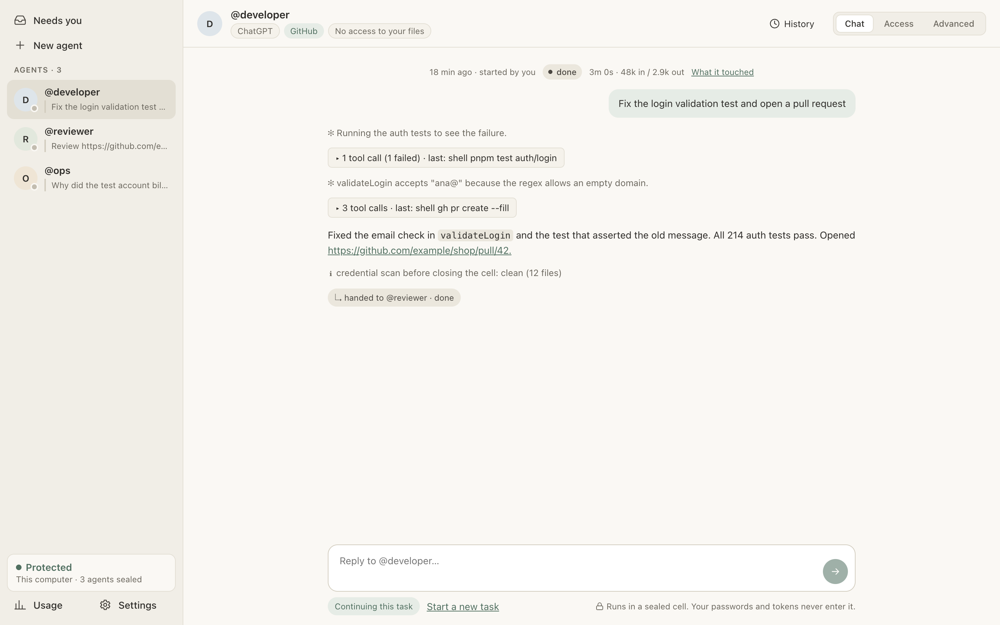

# Anchi / 安栖

**Run coding agents with credentials kept outside their task environments.**

Anchi puts an egress proxy, an encrypted vault and an approval queue between coding agents and
the services they use. On your own computer it protects your own `claude` and `codex` sessions
without a VM. On a remote Linux server it runs a team of Codex, Claude Code and Hermes agents in
disposable cells: give each agent a role, connectors and skills, then follow its tasks, review
held writes and inspect network access from the desktop app. A terminal UI and CLI are also
available.

[Getting started](docs/GETTING_STARTED.md) · [Documentation](docs/README.md) ·
[Releases](https://github.com/jwfing/anchi/releases) · [Security model](SECURITY.md) ·
[Contributing](CONTRIBUTING.md)

**Development preview:** public binaries are available; packages are unsigned and Anchi has
not completed a security audit. Start with test accounts and non-sensitive projects. Hermes has
not been verified against a live endpoint; PostHog, Sentry, Firecrawl, Figma, Discord, X and
Reddit have not yet been exercised against live accounts.



*The desktop app against a stand-in daemon with synthetic example data; no live accounts.
The same team in the terminal: [TUI preview](docs/assets/tui-team.svg).
[Reproduce both](docs/assets/README.md).*

## Two ways to run it

| Placement | Where | What it does |
|---|---|---|
| This computer ([host placement](docs/HOST_PLACEMENT.md), the default) | macOS on Apple Silicon or Linux x86_64 | Your own `claude` and `codex` sessions keep running as before, inside their runtimes' sandboxes, with their traffic routed through Anchi's proxy. Connected credentials never enter the session: it sees placeholders, the proxy injects the real value on the service's hosts, and high-risk writes wait for your approval. Needs only the `openssl` command line. No agent cells. |
| A remote server ([remote server](docs/REMOTE_SERVER.md)) | A Linux server you can SSH into (Debian 12+ / Ubuntu 22.04+, for example an [instabox](https://instabox.dev) VM) | The agent team: each task runs in a disposable, network-isolated cell, with the trusted services beside it on the same machine. The desktop app, TUI and CLI reach it over SSH. |

## What you can do

- **Keep credentials out of agent sessions and cells.** Connect GitHub, AWS, Linear and other
  supported services once; agents hold placeholders, and the proxy substitutes the credential on
  allowed requests only.
- **Review writes that need approval.** Set `approvals: {github: ask}` to hold GitHub writes.
  Listed high-risk operations (merges, pushes to `main`, deletions, access changes) are held by
  default, with explicit global and per-agent exceptions.
- **Give agents separate jobs** on a remote server. Use different runtimes, instructions,
  connectors and skills for development, review or operations. Agents can delegate to named
  teammates, run on schedules and poll for new items.
- **Follow the work.** See running tasks, tool activity, results and delegation in the desktop
  app. Open a task's conversation to continue it, and review approvals and usage in their views.

## Install

Install the desktop app and its command-line tools:

```bash
curl -fsSL https://anchi.elseward.xyz/install.sh | sh -s -- --desktop
```

Open `~/Applications/Anchi.app` on macOS, or **Anchi** in the applications menu on Linux
(`anchi-desktop` also opens it). The desktop app guides you through setup. For a server or
terminal-only workflow, see [terminal installation](docs/GETTING_STARTED.md#installer-options).

The app bundles Node and its dependencies. No source checkout, pnpm or Python is needed on your
computer. The installer verifies the archive checksum; this is not publisher signing. See
[installer options and source installation](docs/GETTING_STARTED.md) to inspect the script or
pin a version. Model usage consumes your subscription quota or API credit.

On this computer, **Prepare** starts Anchi's services and unlocks the vault, and `anchi host
enable` (or the card under **Settings**) writes the sandbox and proxy settings of Claude Code and
Codex after a confirmation; `anchi host disable` restores them. For a server, add it under
**Settings → Machines** (or `scripts/remote.sh`), prepare it, select an agent in **Team** and send
a first task, such as "Explain what tools you have access to. Do not change anything." If a task
fails, see [first-task troubleshooting and CLI examples](docs/FIRST_TASK.md).

## How access works

```text
This computer:   claude / codex session (runtime sandbox)
                        │  placeholders, proxy port
                        ▼
                 Anchi daemon + host services: proxy, vault, approvals  →  APIs

Remote server:   Desktop / TUI / CLI ──SSH──▶ daemon
                                                ├─ untrusted task cells (runtime, tools, skills)
                                                └─ trusted proxy + vault + connector services → APIs
```

The proxy substitutes credentials for allowed API requests; trusted connector services perform
supported operations on the agent's behalf. Agents hold placeholders for these managed
credentials.

| Control | Default and limits |
|---|---|
| Connectors | Only those listed on the agent (on this computer: those you connected). Available: GitHub, AWS, Linear, PostHog, Sentry, Firecrawl, Figma, Discord, Gmail, Drive, Notion, Slack, [X](docs/X_SETUP.md) and [Reddit](docs/REDDIT_SETUP.md). X and Reddit publishing asks for approval unless set to `auto`, which lets agents post under your account without a person. Gmail is read-only; Discord supports REST only. Service connectors run on a remote server only. |
| Network | Omitting `egress` allows public Internet access. `egress: []` allows runtime and configured connector hosts only; a nonempty list adds hosts. Firecrawl can fetch remote URLs outside this list. |
| Writes | Ordinary writes can run automatically. `approvals: {connector: ask}` holds that connector's writes. Listed high-risk patterns are held by default; `highRisk.disable` can exempt patterns globally or per agent (also from the agent settings panel). Explicit `ask` still holds those writes. |
| Files | On this computer the runtime's own sandbox decides what a session may read and write; Anchi denies its credential files. In a cell an agent has its own persistent home and nothing of yours. |
| Data | Content an agent reads can reach its model and allowed destinations. Credential isolation does not keep content local or prevent every misuse of allowed access. |

The high-risk list covers specific operations, not every destructive action. Large streamed git
pushes have additional refusal rules. See [SECURITY.md](SECURITY.md) for the complete boundaries,
exceptions and private reporting route.

## Next steps

| Goal | Guide |
|---|---|
| Protect your own `claude` and `codex` sessions | [Host placement](docs/HOST_PLACEMENT.md) |
| Set up a server for the agent team | [Remote server](docs/REMOTE_SERVER.md) |
| Finish a first task without a business account | [First task](docs/FIRST_TASK.md) |
| Add a connector or teammate | [Agent team](docs/AGENT_TEAM.md) |
| Use keyboard navigation and the command palette | [TUI keys](docs/KEYBINDINGS.md) |
| Automate tasks and inspect JSON output | [CLI reference](skills/anchi/references/cli.md) |
| Let a host-side coding agent operate Anchi | [Install the Anchi skill](skills/README.md) |
| Upgrade or understand what changed | [Changelog](CHANGELOG.md) and [Releases](https://github.com/jwfing/anchi/releases) |
| Report a problem or propose a feature | [Issues](https://github.com/jwfing/anchi/issues/new/choose); [private vulnerability reporting](https://github.com/jwfing/anchi/security/advisories/new) |

After updating the app with `anchi update`, check the release notes for required server updates
such as `anchi setup install`. App updates do not automatically update a server's components.

## Contribute

Start with [CONTRIBUTING.md](CONTRIBUTING.md), the [repository map](docs/architecture/REPOSITORY.md)
and [roadmap](docs/ROADMAP.md). Bug reproductions, onboarding feedback, docs and boundary tests
are useful contributions. Check the [help wanted issues](https://github.com/jwfing/anchi/labels/help%20wanted)
and discuss substantial changes in an issue first.

```bash
pnpm --dir anchi install
python3 -m venv .venv
.venv/bin/python -m pip install -r requirements-test.txt
make check PYTHON=.venv/bin/python
```

Offline checks require Node 22+, pnpm and Python 3.11+; they use no server, account or model.
Live checks are separate and explicit. All maintained documentation is in English.

[Apache License 2.0](LICENSE). Copyright 2026 Junwen. Dependencies retain their own notices.
Anchi is pronounced *AHN-chee*; 安栖 means a safe place to settle and rest.
