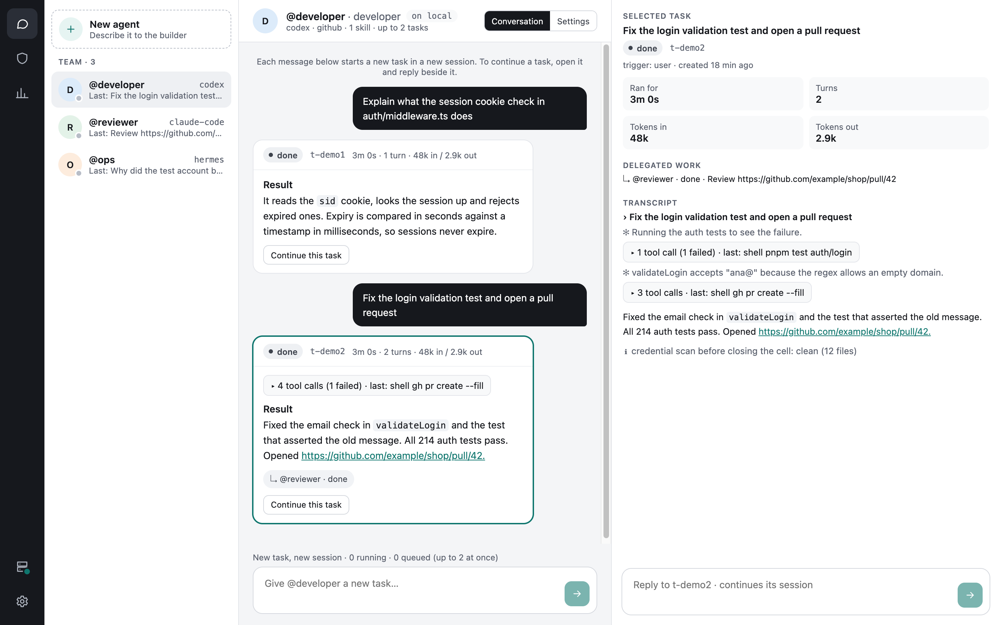

# Anchi / 安栖

**Run a team of coding agents with credentials kept outside their task environments.**

Anchi runs Codex, Claude Code and Hermes agents on your own machine. Give each agent a role,
connectors and optional project folders, then follow its tasks, review held writes and inspect
network access from the desktop app. A terminal UI and CLI are also available.

[Getting started](docs/GETTING_STARTED.md) · [Documentation](docs/README.md) ·
[Releases](https://github.com/jwfing/anchi/releases) · [Security model](SECURITY.md) ·
[Contributing](CONTRIBUTING.md)

**Development preview:** public binaries are available; packages are unsigned and Anchi has
not completed a security audit. Start with test accounts and non-sensitive projects. Linux
support is experimental. Hermes has not been verified against a live endpoint; PostHog, Sentry,
Firecrawl, Figma, Discord, X and Reddit have not yet been exercised against live accounts.



*The desktop app against a stand-in daemon with synthetic example data; no live accounts.
The same team in the terminal: [TUI preview](docs/assets/tui-team.svg).
[Reproduce both](docs/assets/README.md).*

## What you can do

- **Give agents separate jobs.** Use different runtimes, instructions, connectors, skills and
  folders for development, review or operations. Agents can delegate to named teammates.
- **Work with code and services.** Share a project folder read-only or writable; connect GitHub,
  AWS, Linear and other supported services without placing their credentials inside task cells.
- **Follow the work.** See running tasks, tool activity, results and delegation in the desktop
  app. Open a task's conversation to continue it, and review approvals and usage in their views.
- **Review writes that need approval.** Set `approvals: {github: ask}` to hold GitHub writes.
  Listed high-risk operations are held by default, with explicit global and per-agent exceptions.

Use Anchi when you want persistent agent roles, isolated tasks and account access controlled
outside the agent. It adds a VM, a trusted daemon and setup work to using an agent CLI directly.
For a single local task that does not need these controls, your existing runtime CLI may be enough.

## Install and run a first task

| Host | Status | Prerequisites |
|---|---|---|
| macOS on Apple Silicon | Supported | Lima and Python: `brew install lima python` |
| Linux x86_64, glibc (Ubuntu 22.04+ / Debian 12+) | Experimental | Lima, Python 3.11+, QEMU and KVM access; [Linux setup](docs/GETTING_STARTED.md#linux-prerequisites) |
| Intel Mac, Windows, other architectures | Unsupported | — |

Install the desktop app and its command-line tools:

```bash
curl -fsSL https://anchi.elseward.xyz/install.sh | sh -s -- --desktop
```

Open `~/Applications/Anchi.app` on macOS, or **Anchi** in the applications menu on Linux
(`anchi-desktop` also opens it). The desktop app guides you through setup.
For a server or terminal-only workflow, see [terminal installation](docs/GETTING_STARTED.md#installer-options).

The app bundles Node and its dependencies. No source checkout or pnpm is needed. The installer
verifies the archive checksum; this is not publisher signing. See [installer options and source
installation](docs/GETTING_STARTED.md) to inspect the script or pin a version.

Getting started prepares the VM, vault and your selected runtime in one confirmed operation,
then helps you connect an account, review a starter and try an editable sample code-review task.
New VMs use recommended resources (half the host's CPUs and memory, minimum 1 CPU / 2 GiB);
advanced settings let you choose another size. Release packages download checksum-verified
base and runtime layers; source installations build them locally. The selected runtime is
prepared before the first task. Setup time still depends on downloads and VM provisioning.
Model usage consumes your subscription quota or API credit.

After setup, select your agent in **Team** and send a first task, such as
"Explain what tools you have access to. Do not change anything." Click the task to open its
conversation and results. Use **Agent builder** to create and review more agents.
If a task fails, see [first-task troubleshooting and CLI examples](docs/FIRST_TASK.md) before
connecting more accounts.

## How access works

```text
Host: Desktop / TUI / CLI → trusted daemon
                                   │
Lima VM:                           ├─ untrusted task cells (runtime, tools, skills)
                                   └─ trusted proxy + vault + connector services → APIs
```

Each task gets a disposable cell inside the VM. The proxy substitutes credentials for allowed
API requests; trusted connector services perform supported operations on the agent's behalf.
Agents hold placeholders for these managed credentials.

| Control | Default and limits |
|---|---|
| Connectors | Only those listed on the agent. Available: GitHub, AWS, Linear, PostHog, Sentry, Firecrawl, Figma, Discord, Gmail, Drive, Notion, Slack, [X](docs/X_SETUP.md) and [Reddit](docs/REDDIT_SETUP.md). X and Reddit publishing asks for approval unless set to `auto`, which lets agents post under your account without a person. Gmail is read-only; Discord supports REST only. |
| Network | Omitting `egress` allows public Internet access. `egress: []` allows runtime and configured connector hosts only; a nonempty list adds hosts. Firecrawl can fetch remote URLs outside this list. |
| Writes | Ordinary writes can run automatically. `approvals: {connector: ask}` holds that connector's writes. Listed high-risk patterns are held by default; `highRisk.disable` can exempt patterns globally or per agent (also from the agent settings panel). Explicit `ask` still holds those writes. |
| Project folders | No host folders unless shared as workspaces. Read-only by default; `rw` changes real files. Review those changes before running them on the host. |
| Data | Content an agent reads can reach its model and allowed destinations. Credential isolation does not keep content local or prevent every misuse of allowed access. |

The high-risk list covers specific operations, not every destructive action. Large streamed git
pushes have additional refusal rules. See [SECURITY.md](SECURITY.md) for the complete boundaries,
exceptions and private reporting route.

## Next steps

| Goal | Guide |
|---|---|
| Finish a first task without a business account | [First task](docs/FIRST_TASK.md) |
| Add a project folder, connector or teammate | [Agent team](docs/AGENT_TEAM.md) |
| Use keyboard navigation and the command palette | [TUI keys](docs/KEYBINDINGS.md) |
| Automate tasks and inspect JSON output | [CLI reference](skills/anchi/references/cli.md) |
| Let a host-side coding agent operate Anchi | [Install the Anchi skill](skills/README.md) |
| Upgrade or understand what changed | [Changelog](CHANGELOG.md) and [Releases](https://github.com/jwfing/anchi/releases) |
| Report a problem or propose a feature | [Issues](https://github.com/jwfing/anchi/issues/new/choose); [private vulnerability reporting](https://github.com/jwfing/anchi/security/advisories/new) |

After updating the app with `anchi update`, check the release notes for required VM updates
such as `anchi setup install`. App updates do not automatically update the VM's components.

## Contribute

Start with [CONTRIBUTING.md](CONTRIBUTING.md), the [repository map](docs/architecture/REPOSITORY.md)
and [roadmap](docs/ROADMAP.md). Bug reproductions, onboarding feedback, docs and boundary tests
are useful contributions. Check the [help wanted issues](https://github.com/jwfing/anchi/labels/help%20wanted)
and discuss substantial changes in an issue first.

```bash
pnpm --dir anchi install
python3 -m venv .venv
.venv/bin/python -m pip install -r requirements-test.txt
make check PYTHON=.venv/bin/python
```

Offline checks require Node 22+, pnpm and Python 3.11+; they use no VM, account or model.
Live checks are separate and explicit. All maintained documentation is in English.

[Apache License 2.0](LICENSE). Copyright 2026 Junwen. Dependencies retain their own notices.
Anchi is pronounced *AHN-chee*; 安栖 means a safe place to settle and rest.
